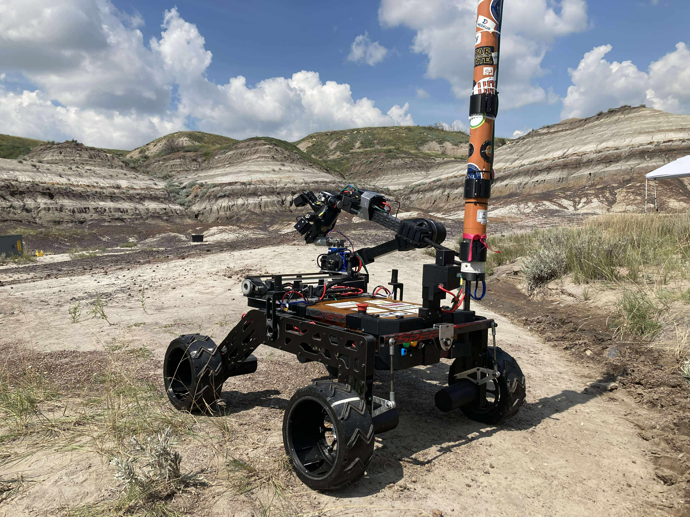
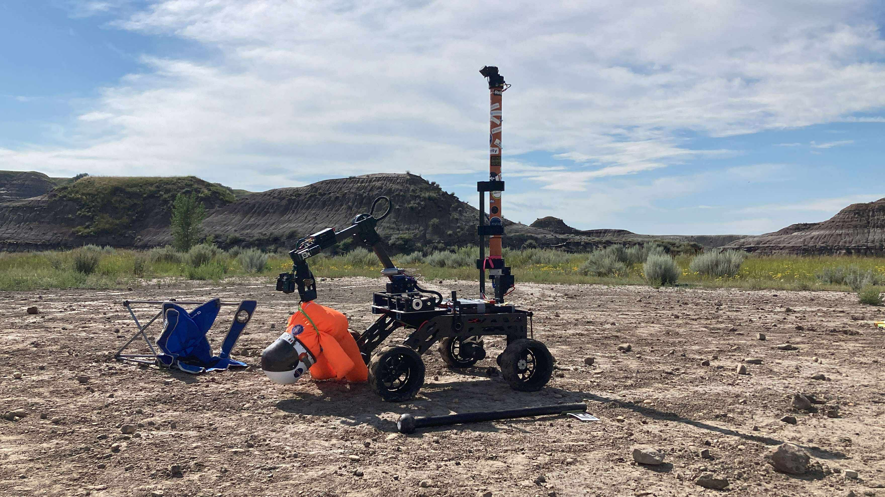
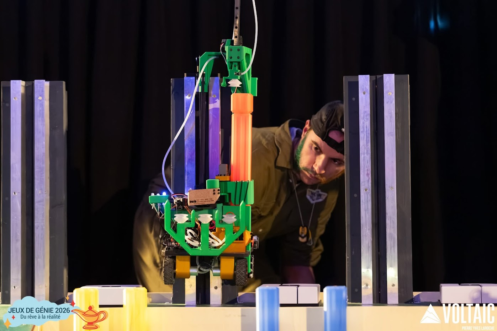
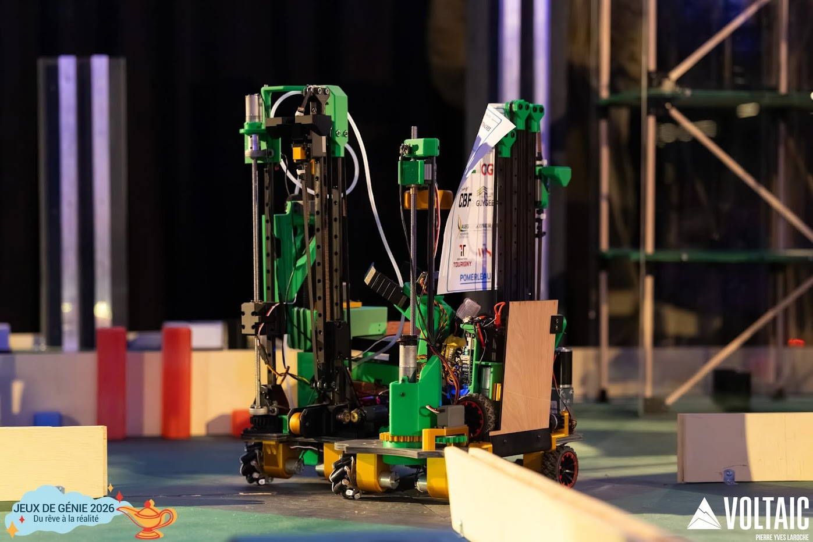
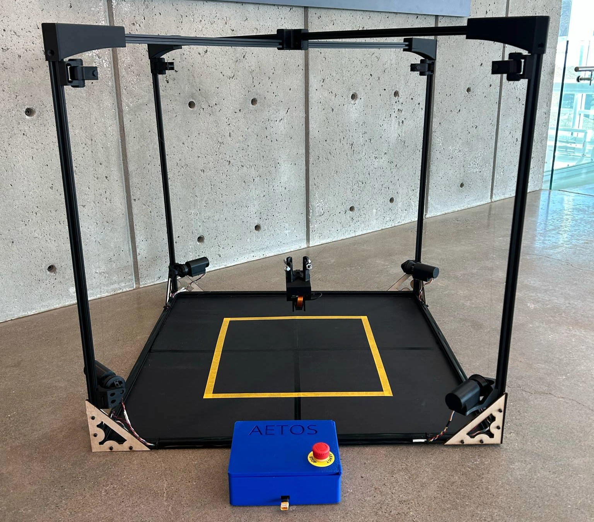

# Émile Savoie

 

Welcome to my portfolio!

I am a Robotics Engineering student at the Université de Sherbrooke, passionate about designing and developing robotic systems, embedded software, and intelligent control applications.

Throughout my academic and extracurricular projects, I have had the opportunity to work on multidisciplinary engineering challenges, ranging from low-level embedded firmware and custom electronics to high-level robotics software and system integration.

The projects presented here are the result of great teamwork and collaboration. However, the focus of this portfolio is on my personal contributions, the technical challenges I tackled, and the engineering solutions I helped develop.

Enjoy!

---

# Rovus – Robotique UdeS

Software & Electronics Lead / Co-Director

The goal of Rovus is to design and build a fully student-developed Mars rover capable of completing a series of autonomous and remotely operated challenges at the Canadian International Rover Challenge (CIRC).

I have been involved in the project for three years, including one year as co-director and technical lead for software and electronics. This experience has allowed me to contribute to nearly every layer of the rover's architecture, from custom PCB design and microcontroller firmware to high-level ROS2 applications and operator interfaces.

One of the main challenges of this project is integrating multiple independently developed subsystems into a reliable and cohesive robotic platform. My work has therefore focused not only on implementing individual features, but also on designing reusable software components, improving communication between subsystems, and ensuring reliable operation in demanding competition environments.

## Personal Contributions

### Robotics Software & Control

- **Drivetrain control (ROS2):** Development of the high-level control architecture for the rover's drivetrain, interfacing with low-level motor controllers and translating operator commands into motion commands.
- **Robotic arm kinematics:** Development of an inverse kinematic controller using differential kinematics, allowing the operator to control the arm's end effector in Cartesian coordinates.
- **Manipulator control:** Integration of high-level ROS2 control with low-level motor interfaces, including CubeMars actuators.
- **Autonomous perception:** Integration of the Unitree L1 LiDAR for obstacle detection and avoidance features.
- **Operator interface:** Development of a Qt6-based mission control application, providing an interface for rover operation and subsystem management.

### Embedded Software & Electronics

- Development of hardware-specific firmware for ESP32-based control boards.
- Design of reusable C++ libraries for communication and hardware interfacing.

### Software Architecture & Development Practices

- Development of a common C++ codebase shared between embedded and Linux-based applications.
- Implementation of compile-time polymorphism using C++ templates, CRTP, and concepts to reduce runtime overhead and improve code reusability.
- Implementation of automated testing and CI/CD workflows to improve software reliability.
- Refactoring of existing software components to improve maintainability, execution efficiency, and consistency across subsystems.

## Results

- **CIRC 2025:** 5th place internationally, 2nd place in Canada, and winner of the Arm Dexterity Challenge.
- **CIRC 2024:** 5th place internationally, 2nd place in Canada.
- **CRQRC 2024:** 1st place.

---

# La Machine – Jeux de génie

Software Lead & Pilot

La Machine is a multidisciplinary engineering competition held as part of the Jeux de génie. The objective is to design and build a robotic solution capable of completing a series of challenges on a predefined course, while maximizing its score according to a detailed grading rubric.

The project brings together mechanical, electrical, and software engineering, with a particularly demanding integration phase. Over approximately four months, our team developed three robots, each with different mechanisms and functionalities, coordinated through a common control system.

As software lead and pilot, I was responsible for developing the embedded software architecture, implementing actuator control, and establishing communication between the operator interface and the robots.

## Personal Contributions

### Embedded Software & Control

- **Motor control:** Development of low-level firmware for the Teensy 4.1, including interfacing with DRV8243-Q1 motor drivers.
- **Actuator management:** Implementation of control logic for more than 50 actuators distributed across the three robots.
- **Hardware interfacing:** Development of embedded interfaces for motors, solenoids, and other electromechanical actuators.
- **Control architecture:** Organization of the software into reusable modules to simplify the integration and operation of the different mechanisms.

### Communication & Electronics

- **Wireless communication:** Development of the RF communication link between the operator controller and the robots.
- **Custom PCB design:** Design and implementation of a dedicated solenoid driver PCB, allowing multiple solenoids to be controlled directly through MCU GPIO signals.
- **System integration:** Coordination of software and electronics interfaces to ensure reliable communication and actuation across the three robotic platforms.

My role as pilot also gave me the opportunity to validate the control system under real competition conditions, identify operational limitations, and adapt the software to the practical requirements of the challenges.

## Results

- **Jeux de génie 2025:** 1st place.

---

# Aetos – School Project

Software Design Lead

Aetos was a four-month multidisciplinary engineering project focused on designing and developing a vision-enabled cable-driven robot from scratch.

One of the project's main objectives was to create an open-source solution, with a software architecture that could be easily reproduced, deployed, and extended.

As software design lead, I was responsible for establishing the overall software architecture, defining the interfaces between the embedded and high-level systems, and coordinating the implementation of the different software components.

## Personal Contributions

### Embedded Software

- **Microcontroller architecture:** Design of the low-level software architecture using an ESP32-WROOM32.
- **Motor control:** Development of embedded interfaces for controlling the robot's motors.
- **Hardware interfacing:** Implementation of communication and control interfaces between the embedded system and the rest of the platform.

### Robotics Software

- **ROS2 architecture:** Design of the high-level software architecture, organizing the different functionalities into ROS2 nodes and communication interfaces.
- **Motor control:** Development of high-level motor control interfaces, allowing the robot to be operated through the ROS2 environment.
- **Operator interface:** Development of the communication interface between the robot and its operator controller.

### Software Infrastructure & Integration

- **Docker environment:** Development of a containerized software environment to simplify deployment and ensure consistency across development machines.
- **Electrical integration:** Design and implementation of the robot's electrical enclosure, organizing the electronics and facilitating system integration.
- **System integration:** Definition and validation of the interfaces between the embedded controller, high-level software, and electrical subsystems.

---

# ECHO – Capstone University project

Embedded Software & Control Systems

ECHO is a multidisciplinary engineering project focused on the development of embedded control systems for haptic applications. The project involves designing and integrating custom electronics, embedded firmware, and control algorithms to interface with electromechanical systems.

My work has primarily focused on embedded software architecture, hardware abstraction, and low-level control. A key objective has been to develop reusable and hardware-agnostic software components that can be deployed across different microcontrollers and embedded platforms without compromising performance or maintainability.

## Personal Contributions

### Embedded Software Architecture

- **Hardware abstraction:** Design of a hardware abstraction layer (HAL) to decouple application logic from hardware-specific implementations, facilitating portability across embedded platforms.
- **Generic programming:** Development of reusable C++23 components using templates, concepts, and compile-time polymorphism to minimize runtime overhead and enforce interface requirements at compile time.
- **Hardware-agnostic libraries:** Design of modular C++ libraries that separate hardware dependencies from application logic, allowing the same interfaces and control components to be reused across different platforms.
- **Peripheral interfacing:** Development of hardware-specific implementations for STM32 microcontrollers using the STM32 HAL, with an emphasis on clean interfaces and separation of concerns.
- **Software architecture:** Application of modern C++ practices, including RAII, static polymorphism, and compile-time interface validation, to improve memory safety, maintainability, and execution efficiency.

### Motor Control & Haptic Systems

- **Motor control:** Development of embedded control interfaces for BLDC motors and electromechanical actuators.
- **Current control:** Implementation of interfaces for controlling a magnetorheological (MR) clutch through a Maxon ESCON motor controller.
- **Actuator characterization:** Development and integration of mathematical models to relate actuator input commands to their resulting mechanical output.
- **Control architecture:** Design of modular control components to facilitate the implementation and testing of different control strategies.

### Electronics & Hardware Integration

- Development and integration of embedded control electronics based on the STM32H755 microcontroller.
- Hardware interfacing for PWM-driven actuators and motor controllers.
- Separation of application-level control logic from microcontroller-specific peripheral implementations.
